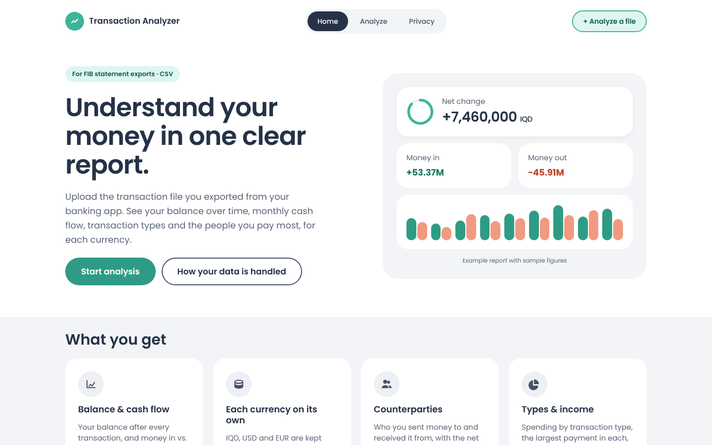
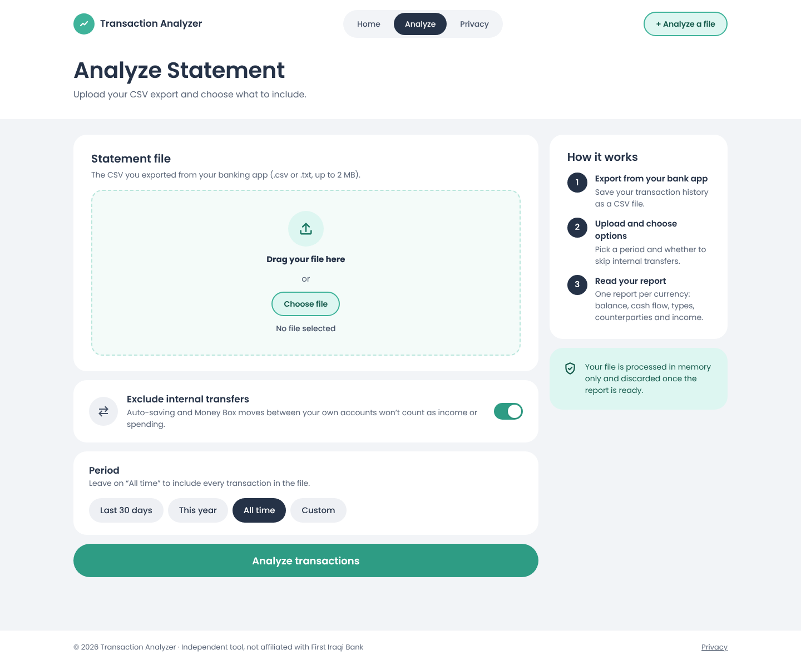
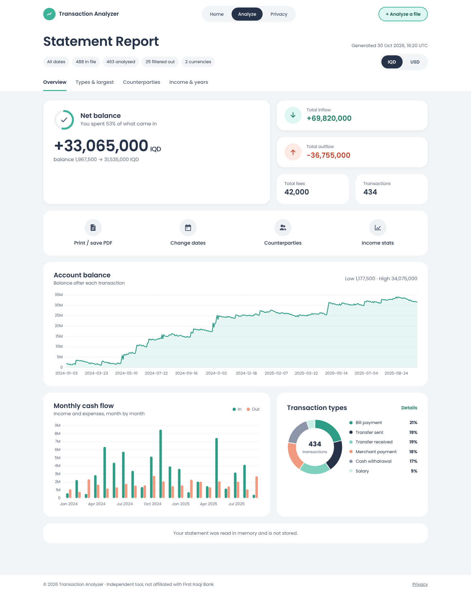
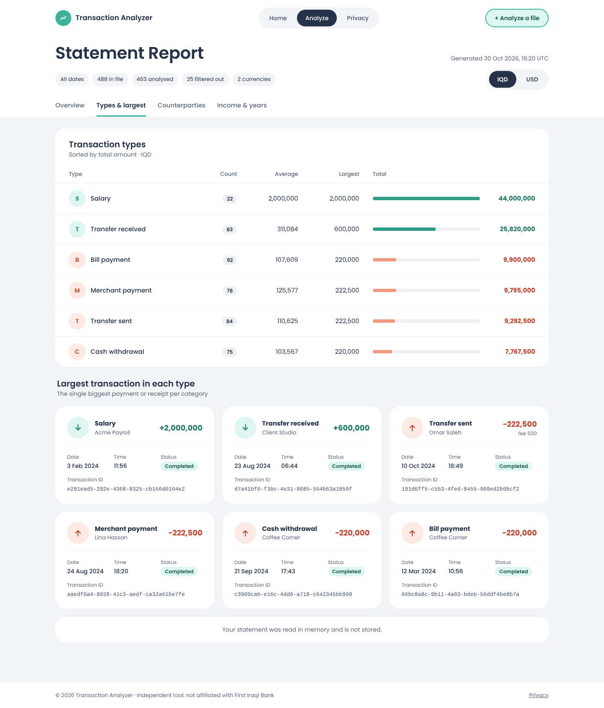
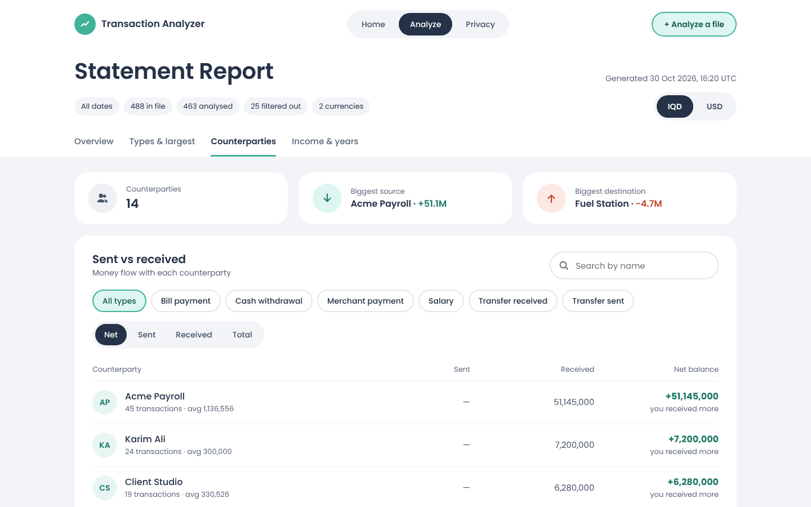
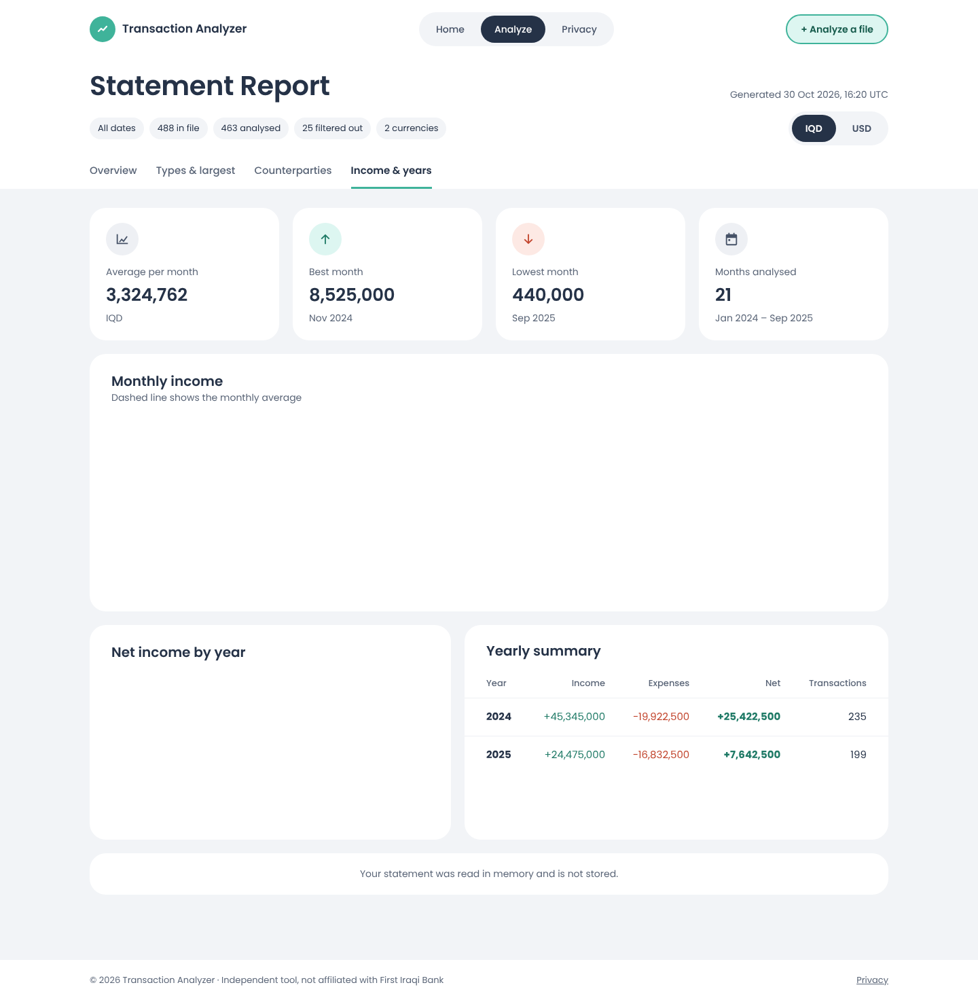
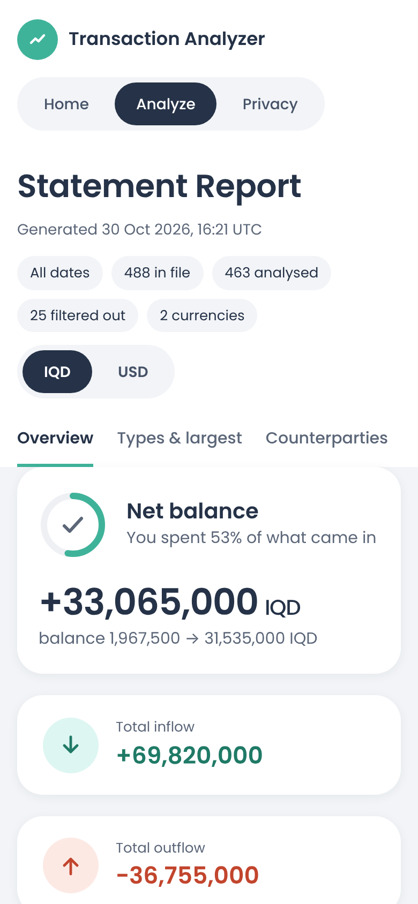

# Transaction Analyzer

A powerful, privacy-focused financial transaction analysis tool that transforms your CSV transaction data into comprehensive insights and visualizations.

You can try it out here:
https://transactionanalyzer-prod-salik.azurewebsites.net
## What This Tool Does

Transaction Analyzer takes your exported transaction files and creates detailed financial reports with interactive charts, trends analysis, and spending patterns. Think of it as your personal financial dashboard that helps you understand where your money comes from and where it goes.

The tool supports multiple currencies (USD, EUR, IQD) and provides deep insights into your financial behavior without storing any of your sensitive data.

## Key Features

**Financial Insights**
- Monthly income vs expense tracking with trend analysis
- Account balance history visualization  
- Transaction categorization and spending pattern analysis
- Multi-currency support with separate analytics for each currency, switchable at the top of the report

**Privacy & Security**
- Zero data storage - your information never leaves your session
- Local processing with immediate data cleanup
- No tracking, cookies, or analytics
- HTTPS encryption for all communications

**Visual Analytics**
- Interactive charts showing balance trends over time
- Cash flow analysis with income/expense comparisons
- Transaction type distribution with detailed breakdowns and the largest transaction per type
- One counterparty view with search, filtering by transaction type and sorting by net, sent, received or total
- Yearly and monthly financial performance reports

## Screenshots

Screenshots use a generated sample statement; the names and amounts are not real.

*Home*



*Analyze: upload a statement, exclude internal transfers and pick a period*



*Report overview: net balance, money in and out, balance history, monthly cash flow and transaction types*



*Transaction types and the largest transaction in each type*



*Counterparties: sent vs received, with search, type filter and sorting*



*Income statistics and yearly summary*



*On a phone*



## Quick Start

**Requirements**
- .NET 8.0 SDK
- A modern web browser

**Running the Application**

1. Clone this repository
2. Navigate to the TransactionAnalyzer directory
3. Run the application:
   ```bash
   dotnet run
   ```
4. Open your browser to `https://localhost:8081`
5. Upload your transaction CSV file and start analyzing

**Supported File Format**
The tool works with FIB (First Iraqi Bank) transaction export format, but the CSV structure can be adapted for other banking formats. Expected columns include transaction ID, counterparty, amount, fees, dates, and transaction types.

## Project Structure

This solution consists of two main components that work together to provide comprehensive transaction analysis:

**Transaction Library** - The core engine that handles CSV parsing, data validation, and transaction modeling. This library includes custom converters for different data types like monetary values, dates, and GUIDs, making it robust enough to handle real-world banking data with its inconsistencies.

**TransactionAnalyzer Web App** - A clean, modern web interface built with ASP.NET Core that provides the analysis service and visualization dashboard. The web app transforms raw transaction data into meaningful insights through statistical analysis and interactive charts.

## Technical Highlights

The codebase demonstrates several advanced .NET concepts including custom CSV type converters, comprehensive unit testing with xUnit, dependency injection, and responsive web design with Chart.js integration.

The analysis engine calculates complex financial metrics like running balances, monthly cash flows, counterparty relationships, and transaction patterns while maintaining excellent performance even with large datasets.

## Development & Testing

```bash
# Run all tests
dotnet test

# Build the entire solution
dotnet build TransactionAnalyzer.sln

# Run with development settings
dotnet run --environment Development
```

The project includes comprehensive test coverage with both unit tests and integration tests, ensuring reliability when processing your financial data.

## Contributing

This project welcomes contributions! The modular architecture makes it easy to add new analysis features, support additional file formats, or enhance the visualization capabilities.

## License

[MIT License](https://github.com/Dersalik/FibTransactionAnalyzer/blob/master/LICENSE)

---

**Privacy Promise**: This tool processes your data locally and never stores, shares, or transmits your financial information to external services. Your privacy and security are our top priorities.
